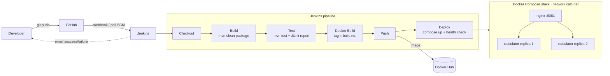

# Calculator REST API — End-to-End CI/CD Pipeline

CSE 816 Software Production Engineering — Mini-Project

A Spring Boot calculator REST API with an automated DevOps pipeline: a push to GitHub
triggers Jenkins, which builds, tests, packages and containerises the app, pushes the image to
Docker Hub, and deploys it with Docker Compose behind an Nginx reverse proxy.

| | |
|---|---|
| **Stack** | Java 21 · Spring Boot 3.5 · Maven · JUnit 5 |
| **CI/CD** | Jenkins (declarative `Jenkinsfile`) |
| **Containers** | Docker (multi-stage) · Docker Compose · Nginx |
| **Docker Hub** | https://hub.docker.com/r/itsrp/calculator |

## Architecture



## API

| Operation | Endpoint | Behaviour |
|---|---|---|
| Add | `GET /api/v1/add?a=&b=` | `a + b` |
| Subtract | `GET /api/v1/subtract?a=&b=` | `a - b` |
| Multiply | `GET /api/v1/multiply?a=&b=` | `a * b` |
| Divide | `GET /api/v1/divide?a=&b=` | `a / b`; `b = 0` → HTTP 400 |
| Health | `GET /actuator/health` | `{"status":"UP"}` |

Success:

```bash
$ curl "http://localhost:8081/api/v1/add?a=2&b=3"
{"operation":"add","a":2,"b":3,"result":5}
```

Errors (missing parameter, non-numeric value, `NaN`/`Infinity`, division by zero) return
**HTTP 400** with a structured body:

```bash
$ curl "http://localhost:8081/api/v1/divide?a=5&b=0"
{"timestamp":"2026-10-28T13:39:06.224Z","status":400,"error":"Bad Request",
 "message":"Division by zero is not allowed","path":"/api/v1/divide"}
```

Arithmetic uses `BigDecimal` (16 significant digits), so `0.1 + 0.2` returns `0.3` and
`1 / 3` returns `0.3333333333333333`.

## Build, test and run locally

Requires JDK 21 and Maven 3.9+.

```bash
mvn clean package -DskipTests      # build target/calculator.jar
mvn test                           # run all tests; JUnit XML in target/surefire-reports/
java -jar target/calculator.jar    # http://localhost:8080
```

### Tests

| Test class | Type | Covers |
|---|---|---|
| `CalculatorServiceTest` | JUnit 5 unit (parameterised) | every operation, decimals, negatives, divide-by-zero |
| `CalculatorControllerTest` | `@WebMvcTest` + MockMvc | JSON responses, all 400 error cases |
| `CalculatorApplicationTests` | `@SpringBootTest` + MockMvc integration | full context, real endpoints, `/actuator/health` |

## Docker

```bash
docker build -t itsrp/calculator .
docker run -d -p 8080:8080 itsrp/calculator
curl "http://localhost:8080/api/v1/multiply?a=6&b=7"
```

The [Dockerfile](Dockerfile) is multi-stage:

1. **build** — `maven:3.9.16-eclipse-temurin-21`. `pom.xml` is copied and dependencies are
   downloaded *before* the sources, so that layer is cached until the POM changes.
2. **runtime** — `eclipse-temurin:21-jre-alpine`: JRE only, no Maven/JDK/sources. Runs as a
   non-root `app` user, `EXPOSE 8080`, has a `HEALTHCHECK` on `/actuator/health`.

[.dockerignore](.dockerignore) keeps `target/`, `.git/`, IDE files and secrets out of the build context.

## Docker Compose

```bash
docker compose up -d               # pulls the image, builds nginx, starts everything
docker compose ps
curl -i "http://localhost:8081/api/v1/add?a=2&b=3"   # X-Upstream-Server shows which replica answered
docker compose down
```

[docker-compose.yml](docker-compose.yml) defines:

- **calculator** — 2 replicas, health check on `/actuator/health`, `restart: unless-stopped`,
  memory limit, environment variables. Not published on the host; reachable only via nginx.
- **nginx** — reverse proxy on host port `8081` (config in [nginx/](nginx/)), starts only once
  the API is healthy, load-balances across the replicas.
- **calc-net** — a dedicated bridge network.

Variables (see [.env.example](.env.example)): `DOCKER_IMAGE`, `IMAGE_TAG` (default `latest`),
`HTTP_PORT` (default `8081`).

## Jenkins pipeline

[Jenkinsfile](Jenkinsfile) stages:

| Stage | What it does |
|---|---|
| Checkout | `checkout scm` — pulls the commit that triggered the build |
| Build | `mvn -B clean package -DskipTests`, archives the JAR |
| Test | `mvn -B test`; publishes `target/surefire-reports/*.xml`; a failing test fails the build |
| Docker Build | `docker build` tagged `:<BUILD_NUMBER>` and `:latest` |
| Push | `docker login` with Jenkins credentials `dockerhub-credentials`, pushes both tags |
| Deploy | `docker-compose up -d --wait`, then checks health and calls the API through nginx; rolls back to the last successful build if this fails |

Post actions e-mail the build result (success / failure with log attached).

**Idempotent re-runs:** the Compose project name is fixed (`name: calculator`), so every run updates
the same stack; Compose only recreates containers whose image changed; `disableConcurrentBuilds()`
prevents two deploys racing; a failed deploy rolls back to the previous good image.

### One-time Jenkins setup

1. **Plugins** (Manage Jenkins → Plugins): Pipeline, Git, GitHub, JUnit, Email Extension,
   Timestamper. The "Install suggested plugins" option covers all of these.
2. **Docker access for the Jenkins user**
   - Linux: `sudo usermod -aG docker jenkins && sudo systemctl restart jenkins`
   - Windows: run the Jenkins service under your own Windows account (services.msc → Jenkins →
     Log On) so it can reach Docker Desktop.
3. **Maven** (Manage Jenkins → Tools → Maven installations): add one named **`Maven-3.9`**,
   "Install automatically". The agent also needs JDK 21 on its `PATH`.
4. **Docker Hub credentials** (Manage Jenkins → Credentials → System → Global → Add):
   kind *Username with password*, ID **`dockerhub-credentials`**, username = Docker Hub user,
   password = a Docker Hub **access token** (Account settings → Personal access tokens).
5. **E-mail** (Manage Jenkins → System → *Extended E-mail Notification*): SMTP `smtp.gmail.com`,
   port `465`, *Use SSL*, credentials = Gmail address + a Gmail **App Password**.
   Fill the same in the plain *E-mail Notification* section and use *Test configuration*.
6. **Job**: New Item → *Pipeline* → Pipeline script from SCM → Git →
   `https://github.com/RAMYA-PARSANIA/spe_mini_project.git`, branch `*/main`, script path `Jenkinsfile`.
   Run it once manually so Jenkins registers the triggers declared in the Jenkinsfile.
7. **Webhook** (GitHub repo → Settings → Webhooks): payload URL `http://<jenkins-host>/github-webhook/`,
   content type `application/json`, *Just the push event*. If Jenkins runs on your laptop, expose it
   with `ngrok http 8080` and use the ngrok URL. Without a webhook, Poll SCM (every 2 min) still triggers builds.

Before the first run, set `DOCKERHUB_USER` and `NOTIFY_EMAIL` at the top of the Jenkinsfile.

## Project structure

```
├── src/main/java/com/spe/calculator/
│   ├── CalculatorApplication.java
│   ├── controller/CalculatorController.java   # REST endpoints, input checks
│   ├── service/CalculatorService.java         # arithmetic (BigDecimal)
│   ├── dto/                                   # CalculationResponse, ErrorResponse
│   └── exception/                             # GlobalExceptionHandler + custom exceptions
├── src/main/resources/application.properties  # port, Actuator config
├── src/test/java/com/spe/calculator/          # unit, MockMvc and integration tests
├── nginx/                                     # reverse-proxy Dockerfile + config
├── Dockerfile                                 # multi-stage image build
├── docker-compose.yml                         # calculator x2 + nginx
├── Jenkinsfile                                # CI/CD pipeline
├── pom.xml
├── .dockerignore  .gitignore  .env.example
└── README.md
```
